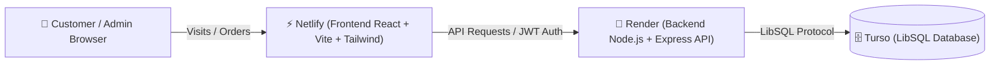

# Kashif Sanitary Supplies 🚿

> **Tagline:** Quality Products. Reliable Supply.  
> **اردو:** کاشف سینیٹری سپلائیز — اعلیٰ معیار کی مصنوعات، قابل اعتماد سپلائی

A modern, mobile-friendly, dual-language (English & Urdu with native Right-to-Left RTL support) website and wholesale management system built for **Kashif Sanitary Supplies**.

---

## 🌟 Key Features

### 🛒 Customer Facing Website
- **Mobile-First & Responsive:** Clean, modern interface designed specifically for phones, tablets, and desktop computers.
- **Dual-Language & True RTL Support:** Instant switching between English (LTR) and Urdu (RTL with Noto Nastaliq Urdu typography).
- **Dynamic Catalog:** Browse editable categories (Pipes & Fittings, Faucets & Taps, Bathroom Accessories, Sanitary Ware, Valves & Connections).
- **Variant & Size Selection:** Clear size and variant selectors (e.g. `1/2 inch (20mm)`, `3/4 inch`, `1 inch`, `4 inch (110mm)`, etc.).
- **Pricing & Request Price:** Displays transparent prices or "Request Price" badges for items with fluctuating wholesale rates.
- **Easy Order Placement:** Cart / Order Drawer with complete customer fields:
  - Customer Full Name
  - Shop Name or Shop Number
  - Phone / WhatsApp Number
  - City / Area
  - Full Delivery Address
  - Special Delivery / Cargo Instructions
- **Unique Order Confirmation:** Generates unique order numbers (`KSS-YYYYMMDD-XXXX`) and provides a 1-tap **Send on WhatsApp** button pre-filled with the order breakdown, plus direct click-to-call dialing.
- **Floating Contact Hub:** Permanent floating WhatsApp and Phone buttons for direct customer communication.

---

### 🔒 Secure Admin Authentication
- **Protected Admin Panel:** Accessible at the Admin Portal tab.
- **Modern Password Hashing:** Uses **bcrypt** with salt rounds for secure password storage.
- **No Hardcoded Passwords or Public Registration:** New admin accounts can only be created via the secure CLI setup script.
- **Secure Sessions:** Signed JSON Web Tokens (JWT) verified on every private backend API route.
- **Admin Password Reset:** Documented CLI tool for the owner (`npm run reset-password`) and in-dashboard password manager.

---

### 📦 Admin Orders & Delivery Management
- **Search & Filter:** Search orders by order number, customer name, shop name, or phone number.
- **Filter by Status & Date:** Statuses include `New`, `Confirmed`, `Contacted`, `Preparing`, `Completed`, and `Cancelled`.
- **New Order Arrival Notifications:** Real-time polling with an audible browser chime and visual flashing badge when a new order arrives.
- **Printable Delivery Slip / Challan:** Open any customer's order and print a clean packing challan for the delivery driver or warehouse packer with one click (`window.print()`).

---

### 📊 Product-Wise Purchasing Summary (Wholesale Procurement)
A dedicated aggregate procurement view built specifically for wholesale bulk purchasing:
- **Combines quantities from selected active customer orders** into one aggregated total for each product and size/variant.
  - *Example:* If **Shop 1** orders 100 L-bows and 50 sockets, and **Shop 2** orders 200 L-bows and 200 sockets, the Purchasing Summary shows:
    - `PPRC 90° Elbow (1/2 inch): 300 Pieces`
    - `PPRC Socket (1/2 inch): 250 Pieces`
- **Dynamic Recalculation:** Select or deselect individual orders or filter by order status (`New`, `Confirmed`, `Preparing`). Cancelled orders are excluded automatically.
- **Different Sizes Kept Separate:** Different sizes and variants are kept on distinct rows.
- **Client Breakdown:** Expand any product to see exactly which shops contributed to the total.
- **Printable Procurement Sheet:** One-click print for taking to factory suppliers or warehouse shelves.
- **Dynamic Product Compatibility:** Seamlessly works with all products added later through the admin panel.

---

### ✏️ Editable Website (Persistent in Turso DB)
- Edit business name, tagline, phone number, WhatsApp number, email, physical warehouse address, and homepage hero texts in both English and Urdu.
- Add, edit, and delete products, categories, images, prices, variants, and stock availability.
- All changes are stored persistently in the database and reflect immediately on the customer store.

---

## 🏗️ Architecture & Tech Stack



| Component | Technology | Hosting Platform |
| :--- | :--- | :--- |
| **Frontend** | React 18, Vite, Tailwind CSS, Lucide Icons | **Netlify** |
| **Backend API** | Node.js, Express, bcryptjs, jsonwebtoken, CORS | **Render** |
| **Database** | Turso LibSQL (SQLite at the edge) | **Turso (app.turso.tech)** |

---

## 🚀 Setup & Deployment Guide

### 1. Database Setup: Turso (`app.turso.tech`)

1. Go to [app.turso.tech](https://app.turso.tech) and log in or create an account.
2. Create a new database:
   - Click **Create Database**.
   - Name your database: `kashif-sanitary-db`.
   - Choose a region close to your primary audience (e.g. Singapore `sin`, Frankfurt `fra`, or London `lhr`).
3. Obtain your Database URL and Auth Token:
   - Under database overview, copy the **Database URL** (starts with `libsql://...`).
   - Click **Generate Token** and copy the **Auth Token**.
4. Keep these two values ready for Render:
   - `TURSO_DATABASE_URL`
   - `TURSO_AUTH_TOKEN`

---

### 2. Backend Deployment: Render (`render.com`)

1. Push this project repository to GitHub or GitLab.
2. Go to [dashboard.render.com](https://dashboard.render.com).
3. Click **New +** and select **Web Service**.
4. Connect your GitHub repository.
5. Configure the service settings:
   - **Name:** `kashif-sanitary-backend`
   - **Root Directory:** `backend`
   - **Environment:** `Node`
   - **Build Command:** `npm install`
   - **Start Command:** `node src/index.js`
   - **Plan:** Free or Starter
6. Add the **Environment Variables** in Render:
   | Key | Value / Description |
   | :--- | :--- |
   | `NODE_ENV` | `production` |
   | `PORT` | `10000` (or leave default assigned by Render) |
   | `TURSO_DATABASE_URL` | Your Turso URL (`libsql://kashif-sanitary-db-username.turso.io`) |
   | `TURSO_AUTH_TOKEN` | Your Turso Auth Token |
   | `JWT_SECRET` | A strong random 32+ character string (e.g. generated via `openssl rand -hex 32`) |
   | `JWT_EXPIRES_IN` | `7d` |
   | `CORS_ORIGIN` | Your Netlify URL (e.g. `https://kashif-sanitary.netlify.app`) |
7. Click **Deploy Web Service**.
8. Once deployed, Render will provide a live URL (e.g. `https://kashif-sanitary-backend.onrender.com`).
   - Check `https://kashif-sanitary-backend.onrender.com/api/health` to confirm the database is connected.

---

### 3. Frontend Deployment: Netlify (`netlify.com`)

1. Go to [app.netlify.com](https://app.netlify.com).
2. Click **Add new site** > **Import an existing project**.
3. Select your GitHub repository.
4. Set the site build configuration:
   - **Base directory:** `frontend`
   - **Build command:** `npm run build`
   - **Publish directory:** `dist`
5. Under **Environment variables**, add:
   | Key | Value |
   | :--- | :--- |
   | `VITE_API_BASE_URL` | Your live Render backend URL (e.g. `https://kashif-sanitary-backend.onrender.com`) |
6. Click **Deploy Site**.
7. Netlify will build your site and give you a public URL (e.g. `https://kashif-sanitary.netlify.app`).
8. Copy your Netlify URL and update the `CORS_ORIGIN` variable in your Render backend settings so CORS allows requests.

---

### 4. Creating the First Admin Account (Secure Setup Process)

To ensure maximum security, admin accounts cannot be registered publicly via a form. Run the CLI tool:

#### Option A: Running locally with remote Turso credentials
In your terminal, navigate to the `backend/` directory:
```bash
cd backend
```
Ensure your `backend/.env` has your `TURSO_DATABASE_URL` and `TURSO_AUTH_TOKEN`.
Run the interactive admin creation command:
```bash
npm run create-admin
```
Or run with non-interactive flags:
```bash
node scripts/create-admin.js --username kashif_owner --email owner@kashifsanitary.com --password YourStrongPassword123!
```

#### Option B: Running on Render Shell
In the Render dashboard for your web service, open the **Shell** tab and run:
```bash
node scripts/create-admin.js --username kashif_owner --email owner@kashifsanitary.com --password YourStrongPassword123!
```

---

### 5. Owner Password Reset Procedure

If the owner forgets their password, they can reset it using the owner recovery tool:

```bash
node scripts/reset-password.js --user kashif_owner --password NewSecurePassword456!
```
Or interactively:
```bash
npm run reset-password
```
*(Enter the username or email, then type the new password. The script hashes the password with bcrypt and updates the database immediately.)*

Additionally, logged-in admins can update their password anytime inside the Admin Portal under the **Account & Security** tab.

---

## 🛠️ Local Development Setup

To run the full stack locally on your computer:

### Step 1: Start Backend
```bash
cd backend
npm install
npm run seed       # Seeds realistic products, categories & default settings
npm run create-admin # Creates initial admin user
npm run dev        # Starts backend on http://localhost:5000
```

### Step 2: Start Frontend
In a new terminal:
```bash
cd frontend
npm install
npm run dev        # Starts frontend on http://localhost:5173
```
Open [http://localhost:5173](http://localhost:5173) in your browser.

---

## 📝 Business Details & Placeholders Replacement Checklist

All business details can be edited directly inside the **Admin Panel > Website Settings** tab without touching any code:

- [ ] **Phone Number:** Update placeholder `+92 300 1234567` with your real office/sales phone number.
- [ ] **WhatsApp Number:** Update placeholder with your business WhatsApp number for direct customer orders.
- [ ] **Email Address:** Update placeholder `sales@kashifsanitary.com` with your real email.
- [ ] **Address (English & Urdu):** Update warehouse market address and city.
- [ ] **Hero Headline & Intro:** Customize website banner text in English and Urdu.
- [ ] **Products & Wholesale Prices:** Add new products, adjust rates, or set items to "Request Price".

---

## 📄 License
All rights reserved © Kashif Sanitary Supplies.
